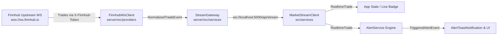

# TradePulse Pro — Real-Time Streaming & Price Alerts Architecture

This document details the real-time event-driven streaming pipeline and price alert subsystem integrated into TradePulse Pro.

---

## 1. Real-Time Streaming Architecture



### Server-Side Gateway (`/api/stream`)
* **Upstream Connection Management (`FinnhubWsClient`):**
  * Connects securely to `wss://ws.finnhub.io?token=<KEY>` strictly on the Node.js Express backend.
  * API tokens and authorization query parameters never leak to client responses, bundles, or logs.
  * Implements bounded reconnection with exponential backoff and randomized jitter (max 30s delay).
  * Automatically resubscribes active stock symbols upon reconnecting.
* **Client Gateway (`StreamGateway`):**
  * Mounts on the existing Node HTTP server at `/api/stream`.
  * Multiplexes incoming client connections and evaluates symbol subscriptions dynamically.
  * When no active clients require a symbol, the upstream subscription is pruned to conserve bandwidth and quota.
  * Defends against malformed payloads and enforces a ceiling of 15 tracked symbols per client connection.

---

## 2. Verified Provider Capability & Entitlements

During initial verification of the Finnhub API key (`db6g4i1r01qspnlbm7p0db6g4i1r01qspnlbm7pg`):
* **REST `/api/health`:** Verified `status: 200`, provider configured.
* **REST `/api/market/quote`:** Verified `status: 200` with live quotes (e.g., AAPL returned genuine market price).
* **REST `/api/market/candles`:** The configured free account plan returns `HTTP 401: PROVIDER_AUTH_FAILURE` for historical stock candles (`/stock/candle`), indicating that candle history requires a higher-tier subscription.
  * The frontend preserves an honest fallback by displaying deterministic historical models clearly marked as **SIMULATED** or **UNAVAILABLE**, without faking data provenance.
* **WebSocket Trades (`wss://ws.finnhub.io`):** Verified live connectivity and receipt of real-time trade packets (`{"type":"trade","data":[...]}`).
  * Real-time trade streaming is active and functional.

---

## 3. Real-Time Price Alerts System

### Rule Configuration
* **Condition Types:**
  * `ABOVE`: Triggers when the market price rises to or above the target (`price >= targetPrice`).
  * `BELOW`: Triggers when the market price falls to or below the target (`price <= targetPrice`).
* **One-Shot Evaluation:** Each rule triggers exactly once, updating its status from `ACTIVE` to `TRIGGERED`, recording `observedPrice` and `triggeredAt`.
* **Validation:** Finite, positive target prices are required. Maximum 25 active rules per browser.

### Local Persistence & Storage Limitations
* Current unauthenticated phase persists alerts and trigger history inside browser `localStorage` (`tradepulse_price_alerts_v1` and `tradepulse_alert_history_v1`).
* **Persistence Boundary Notice:** Alerts are evaluated within active browser sessions against incoming server trades. Server-side durable alerting while the browser is closed is slated for future database/user-auth phases.

### In-App Notifications
* An animated toast notification (`AlertToastNotification`) appears in the bottom right whenever an alert triggers.
* The dedicated **Alerts** tab provides complete management (create, disable, delete, and view trigger history).
* Quick alert configuration is also accessible directly from the **Stock Detail Modal**.

---

## 4. Development & Running

### Starting Both Frontend & Backend
```bash
npm run dev
```

* **Frontend Dashboard:** [http://localhost:3000](http://localhost:3000)
* **Backend Gateway & REST API:** [http://localhost:5000](http://localhost:5000)
* **Client Streaming Gateway:** `ws://localhost:5000/api/stream` (proxied via Vite `/api`)
