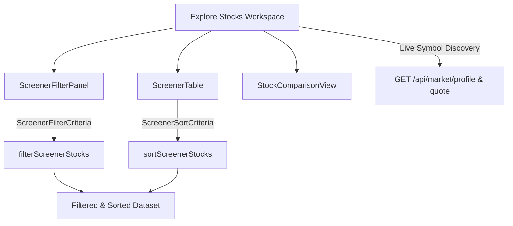

# TradePulse Pro — Stock Screener & Discovery Architecture

This document details the multi-exchange stock screener, security discovery pipeline, side-by-side comparison matrix, and data entitlement model implemented in TradePulse Pro.

---

## 1. Feature Architecture

### Discovery & Real-Time Ingestion
* **Initial Universe:** Combines known US benchmark equities (NASDAQ, NYSE) with dynamic symbol discovery.
* **On-Demand Symbol Discovery:** When a user searches for an untracked security (e.g., `AMD`, `ORCL`, `NFLX`), the client debounces by 500ms and queries:
  1. `GET /api/market/profile?symbol=<TICKER>`: Fetches genuine exchange (`NASDAQ`, `NYSE`), sector/industry (`finnhubIndustry`), and market cap (`marketCapitalization`).
  2. `GET /api/market/quote?symbol=<TICKER>`: Ingests the real-time or cached quote price, day high/low, and percentage change.
  3. The discovered security is automatically integrated into the current screener session with honest **LIVE** or **CACHED** data status.

---

## 2. Multi-Parameter Filtering Model

Users can filter securities using validated parameters:

| Filter Parameter | Type | Validation / Behavior | Data Source |
| :--- | :--- | :--- | :--- |
| **Search Query** | String | Matches symbol or company description (case-insensitive) | Local & Remote `/api/market/search` |
| **Exchange** | Select | `ALL`, `NASDAQ`, `NYSE`, `AMEX`, `BATS` | Company Profile (`exchange`) |
| **Sector / Industry** | Select | `ALL`, `Technology`, `Financial Services`, `Healthcare`, etc. | Company Profile (`finnhubIndustry`) |
| **Price Range** | Number ($) | $ Min & $ Max validated bounds | Live/Cached Quote (`price`) |
| **24h % Change Range** | Number (%) | % Min & % Max (supports Gainers / Losers presets) | Live/Cached Quote (`changePercent`) |
| **Trading Volume** | Number | Minimum volume threshold (omitted when unavailable) | Trade stream & profile volume |
| **Market Capitalization** | Number ($) | Mega Cap preset (≥ $1T), custom bounds | Profile `marketCapitalization * 1M` |

---

## 3. Stable Multi-Column Sorting

The screener table supports bidirectional sorting on:
* **Symbol** (alphabetical)
* **Company Name** (alphabetical)
* **Exchange** (alphabetical)
* **Sector** (alphabetical)
* **Price** (numeric ascending/descending)
* **24h Change %** (numeric ascending/descending)
* **Trading Volume** (numeric, missing values sorted to bottom)
* **Market Capitalization** (numeric, missing values sorted to bottom)

---

## 4. Securities Comparison Matrix

* **Multi-Asset Comparison:** Users can add up to **4 securities** from the screener table into a comparison view.
* **Side-by-Side Metrics:** Displays Last Price, 24h Change, Exchange, Sector, Volume, Market Cap, Day Range, and Data Provenance.
* **Duplicate Prevention:** Prevents re-adding an already compared security.
* **Detail Modal Inspection:** Direct action to inspect full fundamentals and historical chart in the Stock Detail Modal.

---

## 5. Account Entitlements & Known Limitations

1. **Historical Candles (`/stock/candle`):** The configured Finnhub account plan returns `HTTP 403 Forbidden` for historical stock candles. Historical charts continue to operate using explicitly labeled **SIMULATED** fallback models.
2. **Technical Indicators (RSI, SMA, EMA):** Technical indicator filters are intentionally disabled rather than calculating fabricated indicators from non-existent candles.
3. **Non-US Exchanges:** Profile data focuses on major US exchanges (`NASDAQ`, `NYSE`, `AMEX`, `BATS`). Global foreign exchanges without entitlements are excluded.
